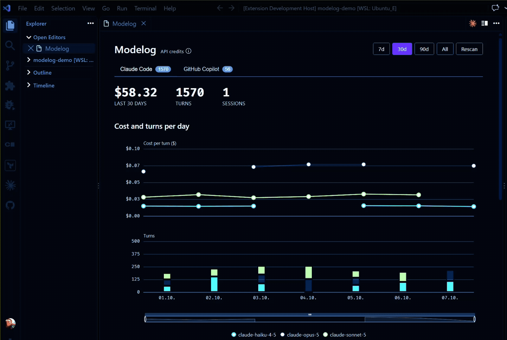

  

<h1 align="center">Modelog</h1>

<strong>See exactly what switching AI models costs and changes — measured from your own session logs, never your code.</strong>

> **Status: Beta.** Core local analysis — Claude Code, GitHub Copilot, and Codex capture, the dashboard, the MCP bridge — works end-to-end against real data. Interfaces and stored data may still change release to release.

---

## Why

You switch models, tweak your instructions file, change how you prompt — possibly many times a week. Then you judge the result by feel.

Existing tools show totals. Totals are dominated by how much work you did, not by the choices you made, so they cannot answer the only question that matters:

> *You switched models on Monday. By Friday, was it better — in cost, in speed, in effort — or did it just feel better?*

Modelog answers that from data already sitting on your disk.

## What it does

- **Reads your local session logs.** Claude Code (`~/.claude/projects/**/*.jsonl`), GitHub Copilot — both the Chat extension (opt-in, its own debug logs) and the standalone Copilot CLI (`~/.copilot/session-state/**/*.jsonl`) — and Codex (`~/.codex/sessions/**/*.jsonl`, CLI and the official VS Code extension share this one store), behind a source-agnostic adapter so other assistants can follow.
- **Prices every turn properly.** Four separately-billed token classes — fresh input, cache read, cache creation, output — with 5-minute and 1-hour cache writes priced apart. In real usage ~95% of input-side tokens are cache reads, so a naive calculation is wrong by orders of magnitude.
- **Compares models on normalised metrics.** Cost per turn, turns per session, cache hit rate — not raw totals.
- **Anchors comparisons on real events.** Model switches are detected from the logs, including mid-session, and drawn on the trend chart.
- **Keeps each assistant in its own unit.** Claude Code and Codex both report in dollars, Copilot in credits — but figures are never summed, compared, or placed on the same axis across assistants, even when the unit matches. Switch between them with one click instead.
- **Lets your assistant query your own usage data.** A local, read-only MCP server exposes the same metrics as tools, behind an explicit opt-in, with a one-command setup for Claude Code, Copilot and Codex — ask your assistant directly instead of reading a chart.
- **Looks like your editor.** Every colour is a VS Code theme variable, so the UI follows your theme — including live theme switches and high-contrast. Enforced in CI.

## See it in action

## Setting up

> **Everything Modelog does is a Command Palette command.** Press <kbd>Ctrl</kbd>/<kbd>Cmd</kbd>+<kbd>Shift</kbd>+<kbd>P</kbd> and type `modelog` to list all of them. Below, anything written as `Modelog: Something` is one of those entries — type it there, don't run it in a terminal.

Start with `Modelog: Open Dashboard`.

**Claude Code and Codex need no setup at all.** Both write session logs by default, and Modelog reads what is already on your disk — including history from before you installed it. If you use either, there should be numbers in the dashboard straight away.

Everything below is off until you turn it on, and none of it is required to use the dashboard.

### GitHub Copilot — capture has to be switched on

Copilot Chat writes **no per-turn usage log by default**, so Modelog has nothing to read until you give it one. This is the most common reason a dashboard looks emptier than expected.

Run `Modelog: Enable Copilot Analysis`. It states the trade-off before changing anything, and does nothing at all if you decline:

- It flips one Copilot setting, `github.copilot.chat.agentDebugLog.fileLogging.enabled`.
- Copilot then writes **your full prompts and code context** to local, unencrypted debug files that do not otherwise exist. Modelog reads only the token counts and costs in them and never the content — but the files are there, and anything else on the machine can read them.
- It is **not retroactive**. Only Copilot sessions started afterwards produce data; ones you have already had cannot be measured.

`Modelog: Copilot Status` then tells you whether it took — whether Copilot Chat is installed, whether logging is on, how many log files were found, and how many turns were stored. Those fail independently, so it reports them separately.

The standalone **Copilot CLI** is a different product and needs none of this: it writes `~/.copilot/session-state/` by default and Modelog picks it up on its own.

### The MCP bridge — ask your assistant about your own usage

Optional. It lets the assistant you already use query Modelog's metrics as tools, so you can ask *"what did switching models actually change this month?"* rather than reading a chart. It is read-only, has no network surface, and exposes no prompts or code.

There is one command per client, because every client is registered by a different mechanism:

| Client | Command | What happens |
| :--- | :--- | :--- |
| **Claude Code** | `Modelog: Enable MCP Server (Claude Code)` | Writes a `modelog` entry into `~/.claude.json` for the open folder. The folder has to be one Claude Code has opened at least once. |
| **Copilot Chat** (in VS Code) | `Modelog: Enable MCP Server (Copilot)` → *GitHub Copilot Chat* | Nothing to write — Modelog already registers with VS Code's own MCP client every time it starts. The command takes you to the two steps that are yours: **start** the Modelog server in VS Code's MCP servers list, and **tick its tools** in the Chat tool picker in Agent mode. |
| **Copilot CLI** | `Modelog: Enable MCP Server (Copilot)` → *GitHub Copilot CLI* | Runs `copilot mcp add` for you, which writes `~/.copilot/mcp-config.json`. |
| **Codex** (CLI and VS Code extension, which share one config) | `Modelog: Enable MCP Server (Codex)` | Runs `codex mcp add` for you, which writes `~/.codex/config.toml`. |
| **Anything else** | `Modelog: Copy MCP Server Configuration` | Puts the JSON on your clipboard to paste wherever that client keeps it. |

Each has a matching `Modelog: Disable MCP Server (…)` command, which removes only the `modelog` entry and leaves every other server alone.

Three things worth knowing before running one:

- **You see the exact command or JSON and the exact file first**, and the file is copied to `<file>.bak` before anything touches it. For Codex and the Copilot CLI, Modelog does not edit the file itself — it runs that assistant's own `mcp add`, so the vendor's format stays the vendor's problem and your model settings, trust levels and comments survive intact.
- **`node` has to be on your `PATH`.** Every client except VS Code spawns the server by running `node`, so Modelog checks first and refuses with a clear message rather than writing config that silently never starts. A GUI-launched editor on macOS inherits no shell profile, so an nvm- or Homebrew-installed `node` can be invisible to it even though it works fine in your terminal.
- **It takes effect in your *next* session, not this one.** All of these clients read their MCP config at session start, so Modelog never claims the server is connected.

`Modelog: MCP Server Status` reports each client separately. They fail for four unrelated reasons — a bundle that would not deploy, a project Claude Code has never seen, a CLI that is not on `PATH`, an entry that was never written — and a single "MCP: off" would send you looking in the wrong place.

### Uninstalling

Modelog's own data needs no attention: VS Code deletes an extension's storage directory when it is uninstalled, and that is where the database lives.

What does need attention is what Modelog wrote **outside** its own storage — Copilot's logging setting, and the MCP entries in Claude Code's, Copilot's and Codex's configs. Left behind, those point at a server file that no longer exists, and Copilot keeps writing prompt-bearing debug files.

Run `Modelog: Remove Modelog's Changes` before uninstalling. It lists only what is actually present on your machine, ticks the restorative items, leaves the destructive ones (backup files, collected history) unticked, and reports each one separately.

If you just uninstall, Modelog runs the same cleanup automatically on the next VS Code start — the restorative items only. It cannot ask you anything at that point, so anything that would delete rather than restore is skipped, and a step it cannot complete is logged under the extension's name rather than guessed at.

### Reading the numbers

- If the auto-detected billing mode is wrong for you, change the `modelog.billingMode` **setting** (Settings → Extensions → Modelog — a setting, not a palette command). On a subscription, figures are labelled estimates at API list rates, because a subscription is not billed per token.
- Each assistant stays in its own unit and is never summed or compared against another. Switch between them with one click.
- A model shown as **cost unavailable** has no rate in the table — it is never priced at a default. Please [open an issue](https://github.com/m8a-io/modelog/issues) if you hit one.

## Privacy

**Modelog never reads your prompts or your code.** The parser extracts timestamps, model ids, token counts and session identifiers, and nothing else — message content is never touched, for either assistant. There is a test asserting this.

Nothing leaves your machine. No network calls, no telemetry, no account.

## Honest numbers

A measurement tool that shows a wrong number is worse than one that shows a gap, so:

- Costs are integer arithmetic — never floating point — in an explicit unit per assistant.
- An unrecognised model is reported as **cost unavailable**, never priced at a default rate.
- Billing mode is auto-detected. On a subscription, figures are labelled as estimates at API list rates, because a subscription is not billed per token.
- Rates live in versioned data files, not in code, and go stale visibly.

## Enterprise

Modelog Enterprise brings team-wide visibility: cost-per-outcome and model-switch patterns rolled up across a team, plus budget alerts — without a manager ever seeing an individual's raw prompts or code. Only derived metrics and labels sync, and only by explicit opt-in; nothing leaves a developer's machine until they choose to turn it on.

Not yet available — follow progress at [modelog.dev](https://modelog.dev) Coming Soon!.

## Documentation

| Document | Contents |
| :--- | :--- |
| [`docs/PRD.md`](docs/PRD.md) | Product requirements — what and why |
| [`docs/DESIGN.md`](docs/DESIGN.md) | Part 1 technical design — how |
| [`docs/MCP.md`](docs/MCP.md) | MCP bridge requirements (Part 2) |
| [`docs/MODEL-SWITCHER.md`](docs/MODEL-SWITCHER.md) | Model switcher proposal and integration feasibility research — draft for review |
| [`docs/PRICE-CHANGE-MONITOR.md`](docs/PRICE-CHANGE-MONITOR.md) | Future CI workflow for OpenAI and Claude price updates and extension releases |
| [`docs/INSTALL-ux.md`](docs/INSTALL-ux.md) | Install, activation and first-run UX |

Contributing? See [`CONTRIBUTING.md`](CONTRIBUTING.md) for build/test instructions and the codebase layout.

## Roadmap

1. **The extension** — local capture, storage, metrics, dashboard, for Claude Code, GitHub Copilot, and Codex. *Done.*
2. **The analysis bridge** — a local MCP server so your existing agent can reason over your own data. *Done.*
3. **Enterprise & web** — team rollups, opt-in sync, modelog.dev. *In progress.*

## Contact

Built by Scott Molinari — <scott.molinari@m8a.io>

Bugs and feature requests: [GitHub issues](https://github.com/m8a-io/modelog/issues).

## Licence

MIT — see [LICENSE](LICENSE). Third-party notices in [NOTICE.md](NOTICE.md).
